<p align="center">
  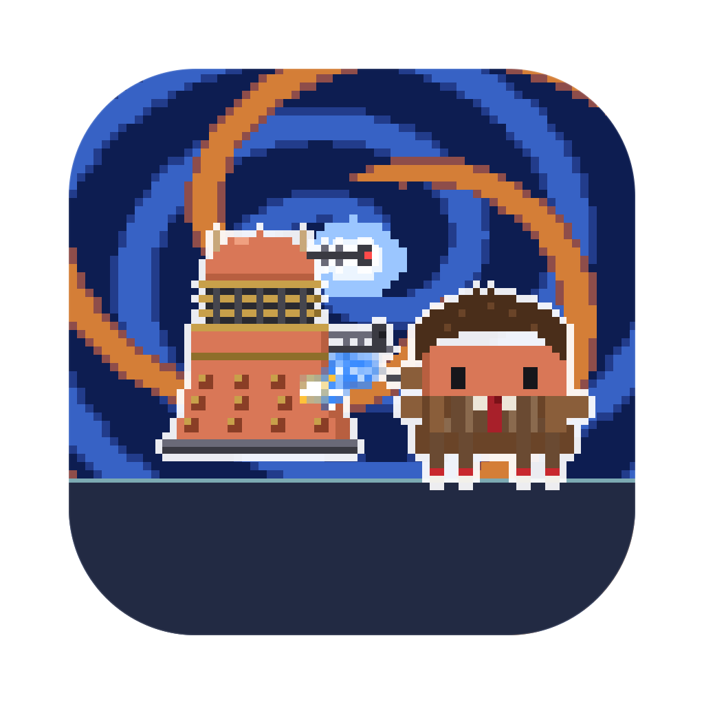
</p>

<h1 align="center">Doctor Clawd</h1>

<p align="center">
  <b>Your AI coding sessions, as a pixel-art time-travel battle on your desktop.</b><br>
  Every session is a Doctor, a companion or a monster, every subagent joins in, and they fight while they work.
</p>

<p align="center">
  <a href="LICENSE"></a>
  
  
  
  <a href="https://github.com/rodclemen/clawd-clash"></a>
</p>

https://github.com/user-attachments/assets/0d2b3baf-7cc7-4742-a2e5-7c2cea5372b7

<p align="center"><sub>🔊 <b>Click the speaker in the player for sound</b>: GitHub starts videos muted. Full 1080p version: <a href="promo/doctor-clawd-promo.mp4">promo/doctor-clawd-promo.mp4</a></sub></p>

> **Doctor Clawd is a universe of [Clawd Clash](https://github.com/rodclemen/clawd-clash).** Same crew, same fights, more universes to switch to. This page shows off the Doctor Clawd universe; see [Get it](#get-it) to install.

<p align="center">
  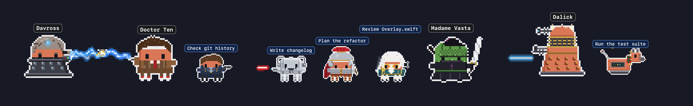
</p>

---

## Contents

- [What it is](#what-it-is)
- [The Doctor Clawd universe](#the-doctor-clawd-universe)
- [The cast](#the-cast)
- [Window mode](#window-mode)
- [Screen saver](#screen-saver)
- [Get it](#get-it)
- [More universes](#more-universes)
- [What's new](#whats-new)

## What it is

You run Claude Code in three terminals. One is thinking, one is waiting for your permission, one finished ten minutes ago and you didn't notice. You alt-tab around to find out.

**Clawd Clash tells you at a glance, without switching windows.** Every Claude Code, Codex, Qwen Code, Gemini CLI or GitHub Copilot CLI session becomes a character in a pixel-art battle across time and space, along the bottom of your screen or in a window of its own.

- 🪛 **Working?** Your Claude points its sonic screwdriver (or fires its gunstick, or throws a cricket ball).
- 💭 **Thinking?** A thought bubble.
- ❗ **Needs you?** A red `!`, and if you ignore it for a minute, it starts jumping up and down. It keeps asking until you answer; press Esc instead and it stands down.
- 😴 **Done and idle?** It stops fighting and passes the time with habits of its own: Doctor Four offers you a jelly baby and twirls his scarf, Eleven puts on a fez, Twelve plays a guitar riff, Captain Jack Harkless drops dead and gasps back to life, Rose Tiler glows gold with the Bad Wolf, Wilf salutes, Osgoode takes a puff of her inhaler, and the Celestial Toyfaker deals a hand of cards. (The Weeping Angle doesn't fidget at all. It just covers its eyes.) After a couple of minutes it sits down; after five it's asleep (zZz).
- 🧑‍🚀 **Spawned subagents?** Companions march in one by one, each labelled with what it's doing, and leave in the TARDIS when they finish.
- 🔍 **Hover** any character for the details: status, how long, the tool it's running, your last prompt.
- 🖱️ **Click** any of them to jump straight to that session's terminal or editor tab.

No dashboard to open, no tab to check. It's just… there, quietly saving the universe.

## The Doctor Clawd universe

Run two Claudes and they square off. Every character is Clawd (Claude Code's little pixel mascot) in costume, and the fights follow the weapons:

| Matchup | What happens |
|---|---|
| sonic screwdriver or energy vs a gun | the gunner gets zapped |
| sonic screwdriver vs a blade | the blade catches the beam |
| gun vs a blade | shots fly, the blade deflects each one off into the sky (Madame Vasta's katana, Rory's gladius) |
| blade vs blade | they close in and duel, blades clashing with sparks |
| gun vs gun | a proper shoot-out: they duck, shots collide mid-air, and bolts ping off Dalick and Cyber armour |
| odd one out | cheers the others on, with sparkles |

The Doctors don't carry guns. Each one's sonic screwdriver has its own colour (Ten's blue, Eleven's green, Thirteen's gold), Doctor Three uses Venusian aikido, Five bowls a cricket ball, and only the War Doctor and the Fugitive Doctor shoot.

**Arch-enemies face off first.** Whenever a pair is on stage together, everyone else shuffles aside so the two of them can have it out: Doctor Ten and Mister Sexton, Twelve and Missy, Four and Davross, the War Doctor and the Dalick Emperor, Amy Puddle and the Weeping Angle, Clara and the Grate Intelligence, River Tune and the Vashta Nerado, Stracks and the Sontaron, and more.

**The TARDIS picks them up.** When a Doctor's or a companion's agent is done, they don't just fade away. The police box wheezes into view beside them with its lamp flashing, the door swings open on the light inside, they step in, and it fades away again.

<p align="center">
  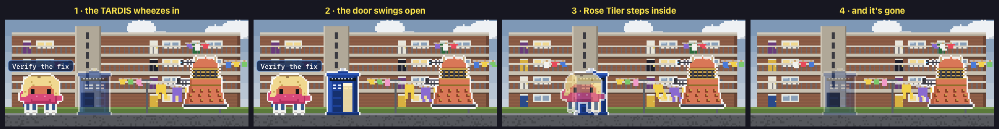
</p>

**Don't blink.** The Weeping Angle only moves while nobody on stage is looking at it. Anyone facing it, and it's stone. Everyone turned away, and it's suddenly much closer.

<p align="center">
  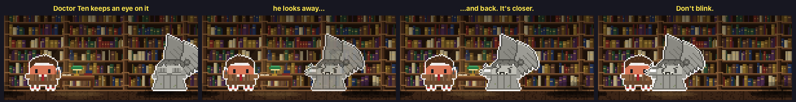
</p>

**Regeneration.** When a Claude session playing a Doctor compacts its context (when it runs out of room, or you type `/compact`), its Doctor goes up in golden fire and comes out as the next Doctor. It's the same session, with a new face.

<p align="center">
  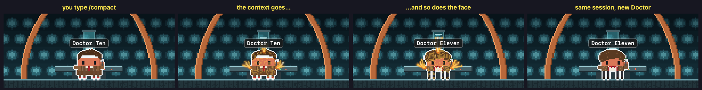
</p>

**Practice, the Doctor Clawd way.** A Claude working with nobody to fight works through practice sets: the Dalicks "Elevate!" a step off the ground, the Cyberpersons march in step, the Sontaron drills, Doctor Four tosses jelly babies, Twelve plays the guitar, and K-Canine plays fetch.

**Doctors against monsters.** Run Claude Code alongside Codex, Qwen Code, Gemini CLI or Copilot CLI: Claude Code plays the Doctors and their friends, the others the monsters, and each one's agents fight for their own side. The outline colour round each character tells you which AI it belongs to.

## The cast

42 villains and 55 heroes (plus one rare guest), any of whom can be a session (drawn large) or an agent (drawn small).

**The Doctors**: Doctor One (*"Hmm!"*), Two (on the recorder), Three (Venusian aikido), Four (jelly babies and a very long scarf), Five (cricket whites, celery), Six (a coat of many colours), Seven (question-mark umbrella, spoons), Eight (pocket watch), Nine (*"Fantastic!"*), Ten (glasses on: *"Allons-y!"*), Eleven (fez, bow tie), Twelve (guitar, sonic sunglasses), Thirteen (*"Brilliant!"*), Fourteen (*"Oh!"*), Fifteen (a dance break), the War Doctor (who scratches NO MORE into a wall) and the Fugitive Doctor.

**Companions and allies**: Susan Foreclaw, Ian Chesterclawd, Barbara Rite, Jamie McCrabmon (Highland charge), Zoe Hairiot (computes on her fingers), Brigadier Lethbridge-Stewed (*"Five rounds rapid"*), Jo Grunt, Sarah Jane Smythe, Leelah (knife throw), K-Canine (*"Affirmative"*), Romanah, Nyssa of Trakken, Tegan Jovanko (*"Brave heart!"*), Pery Brown, Mel Shrub (screams), Ace (baseball bat, Nitro-9), Rose Tiler (Bad Wolf), Captain Jack Harkless, Martha Bones, Donna Nobble (*"Oi!"*), Wilf Moth (salutes), Amy Puddle, Rory Willjams (the Last Centurion stands guard), River Tune (*"Hello, sweetie."*), Clara Oswalt (soufflé), Madame Vasta (tongue flick), Jenny Flynt, Stracks (a grenade "for later"), Bill Pans, Nardoll, Yaz Kahn, Graham O'Brine, Ryan Sinclare, Dan Louis, Ruby Monday (snow falls round her), Belinda Chandler, Kate Stewed and Osgoode (inhaler and scarf). And now and then HEM turns up in a fez.

**The villains**: the Master (*"I am the Master"*), the Burnt Master, the Velvet Master, the Snakeskin Master (spits venom), Mister Sexton (drums four beats), Missy (umbrella, floats like a nanny), the Spy Master, the Ranee, Davross (blue lightning from his fingers), Omegah, Rascilon (the gauntlet), the Celestial Toyfaker (deals cards), Sootekh, the Grate Intelligence, the Valeyarn, the Maestro (conducts), Lady Cassandro (*"Moisturise me!"*), the Clockwork Droid (ticking), the Candyman, a Dalick (*"EXTERMINATE!"*), the Supreme Dalick, the Dalick Emperor, the Mondasian Cyberperson, a Cyberperson (*"DELETE"*), the Cyber Controller, a Sontaron (*"Sontar-ha!"*), the Weeping Angle, the Silents, the Odd, a Zygone, a Silurean, a Sea Devvil, an Ice Warior, an Autom, the Judoom (*"Bo! Ko! To!"*), the Slitheem (farts, giggles), the Sycorex, the Vashta Nerado (*"Hey, who turned the lights out?"*) and the Empty Kid (*"Are you my mummy?"*). Adipoze, Cybermites and Toclafayne only ever turn up as agents.

<p align="center">
  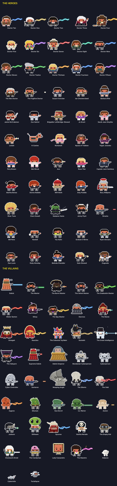
</p>

## Window mode

Clawd Clash opens in a window by default (switch to the desktop from the menu). The whole crew stands in a scene, and every session gets a card: its project, what it's doing right now, your last prompt, its last reply, and its agents in a little tree underneath.

<p align="center">
  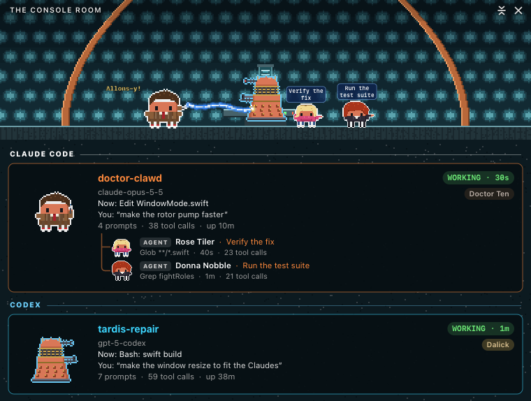
</p>

The scene is set **where the first session's character belongs**: Skarro for the Dalicks, Telos for the Cyberpersons, Paternoster Row for Madame Vasta, Roald Doll Plass for Captain Jack, the Library for the Weeping Angle:

<p align="center">
  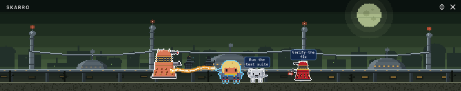
</p>

20 hand-built places, each with its own little animation: the time rotor pumps in the TARDIS console room; the grass ripples under Gallifray's two suns; a Dalick patrol glides across Skarro; fog drifts through Totter's Yard in 1963; washing flaps on the Powell Estate; shadows creep across the floor of the Library; the Smiler booths turn their faces on Starship UK; Vesuvius erupts over Pompeii; the stars swirl over the café in Arles; waves roll in on Bad Wolf Bay; and the Sycorex ship hangs over Christmas London.

<p align="center">
  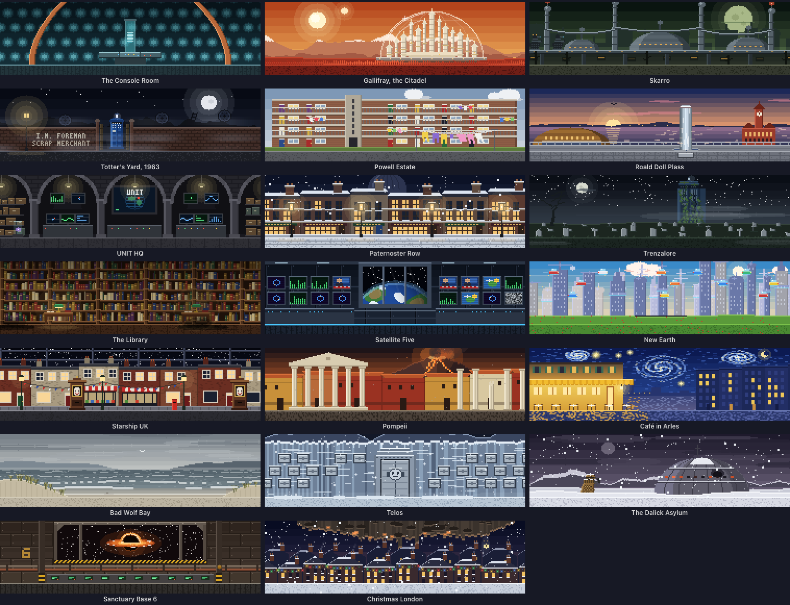
</p>

When the scene moves somewhere new, it travels the way the show does. The TARDIS dematerialises out of one place and into the next, or the trip runs through one of the eras' title sequences: the black-and-white howlaround of 1963, the 1970s slit-scan tunnel of streaking light, the 1980s starfield, the blue and orange time vortex of 2005 with the TARDIS tumbling through it, the explosive vortex of the 2010s, or today's neon one. Each era's comes up more often with its own Doctors and companions on screen. There's a regeneration's golden flare too, and with a Weeping Angle about, the screen might blink four times, the Angle closer each time; with a Dalick about, you might watch through its eyestalk.

<p align="center">
  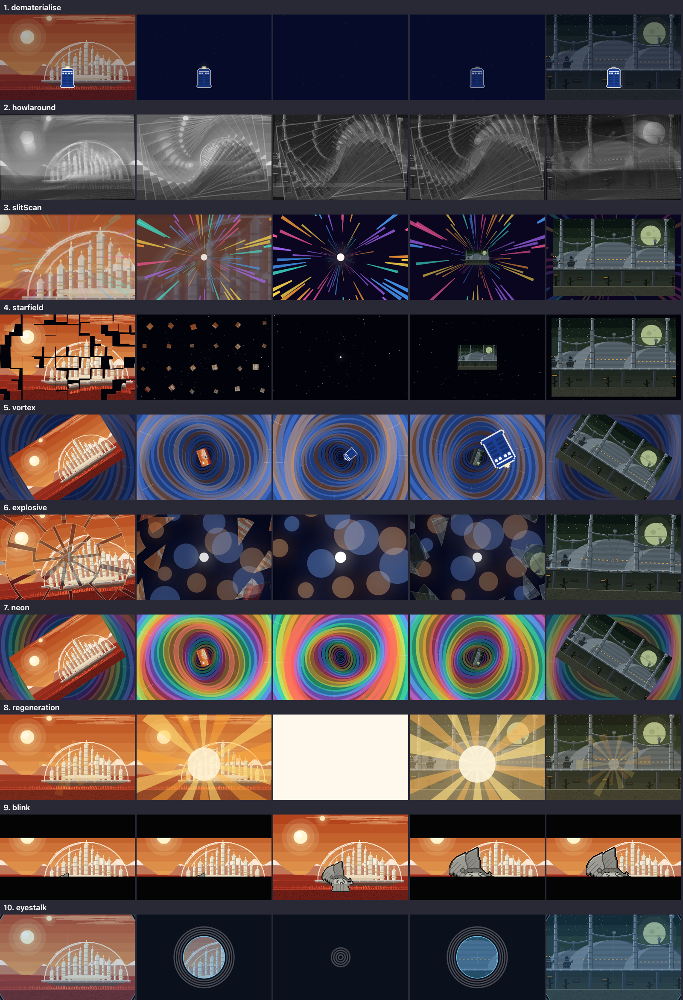
</p>

## Screen saver

<p align="center">
  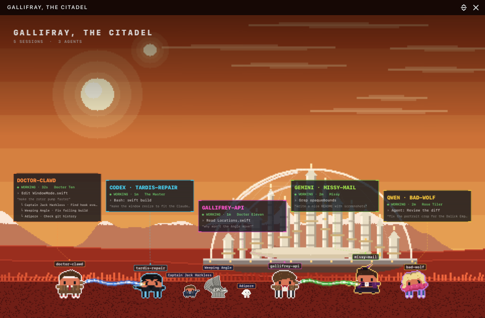
</p>

Clawd Clash comes with a screen saver: the place at full screen and the crew fighting across its floor. Every Claude and agent wears a name tag, each session has a card floating above the crew, a clock sits in the corner, and what happened lately crawls along the bottom. Every 10 minutes it travels somewhere new with one of the transitions above. When there's nothing much to watch, it puts on a show instead: a random crew squaring off, Doctors against monsters. It even shows your sessions with the app closed. Pick **Doctor Clawd** in the screen saver's **Options…** in System Settings.

The window can show the same view, and **Random** location moves the window somewhere new every 10 minutes, the same way.

<p align="center">
  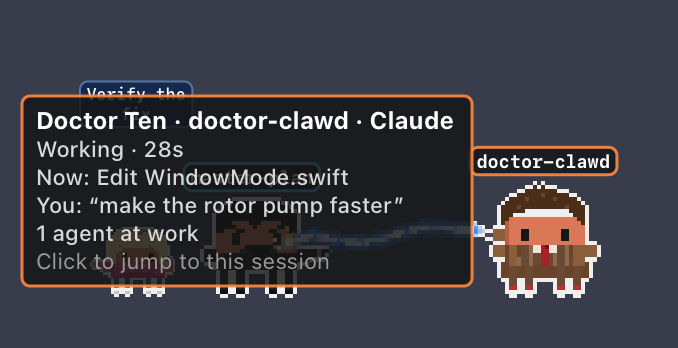
</p>

## Get it

Doctor Clawd is part of **[Clawd Clash](https://github.com/rodclemen/clawd-clash)**, one app with multiple universes. It needs macOS 13+ and at least one of Claude Code, Codex, Qwen Code, Gemini CLI or GitHub Copilot CLI.

It comes with Clawd Clash 3.1.0 and later. With Homebrew:

```sh
brew tap rodclemen/tap
brew trust rodclemen/tap      # newer Homebrew asks you to trust a third-party tap once
brew install --cask clawd-clash
```

Then pick **Settings → Universe → Doctor Clawd** (already have Clawd Clash? `brew upgrade --cask clawd-clash`). Or download the zip from [Clawd Clash's releases](https://github.com/rodclemen/clawd-clash/releases), unzip it and drag **Clawd Clash** to Applications.

Everything else (how it works, the settings, uninstalling, the source and contributing) lives in the **[Clawd Clash repo](https://github.com/rodclemen/clawd-clash)**.

## More universes

Doctor Clawd is one of multiple universes. In **Settings → Universe** you can switch to **[Star Clawds](https://github.com/rodclemen/star-clawds)**, **[Marvelous Clawds](https://github.com/rodclemen/marvelous-clawds)**, **[Detective Clawds](https://github.com/rodclemen/detective-clawds)**, **[The Clawd Files](https://github.com/rodclemen/the-clawd-files)**, **[Stevie Clawdberg](https://github.com/rodclemen/stevie-clawdberg)** or **[Clawd of the Rings](https://github.com/rodclemen/clawd-of-the-rings)**, or pick **Random** to change universe on its own every so often. Switching recasts everyone on screen and moves the scene to one of the new universe's places. Or pick **Clawd Royale** to throw every cast into one scene, each character as themselves, in a new place from any universe every ten minutes.

## What's new

The highlights, in plain words: [CHANGELOG.md](CHANGELOG.md). The full history lives in Clawd Clash.

---

<p align="center"><sub>An independent parody fan project, not affiliated with or endorsed by the BBC. Claude and Clawd belong to Anthropic.<br>Free to use: <a href="LICENSE">MIT licensed</a>.</sub></p>
